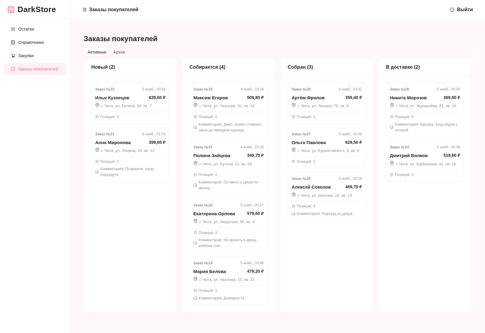
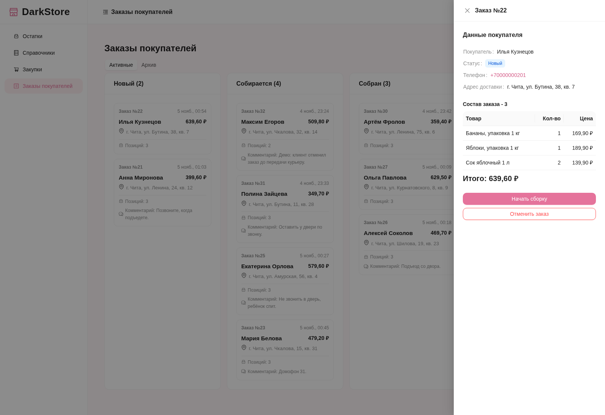
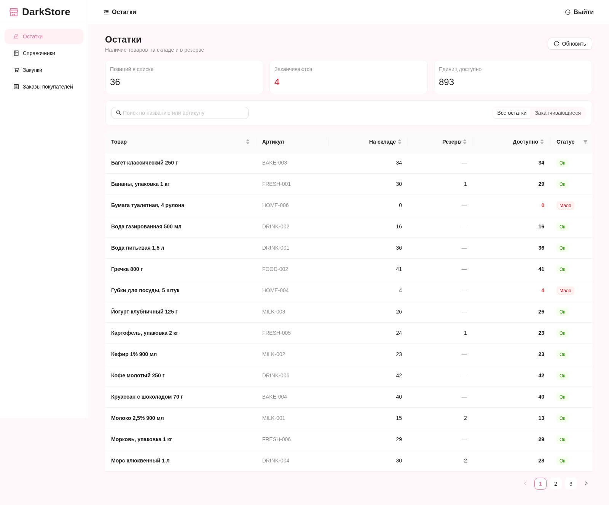
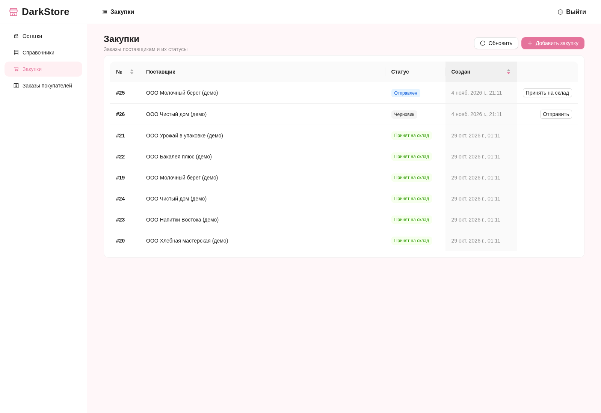
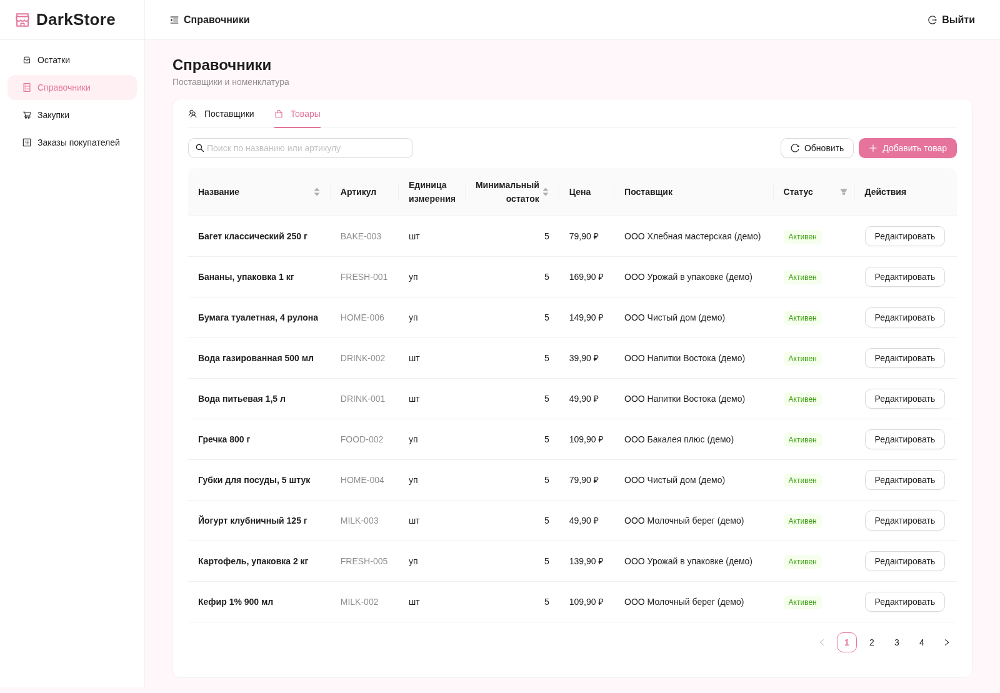
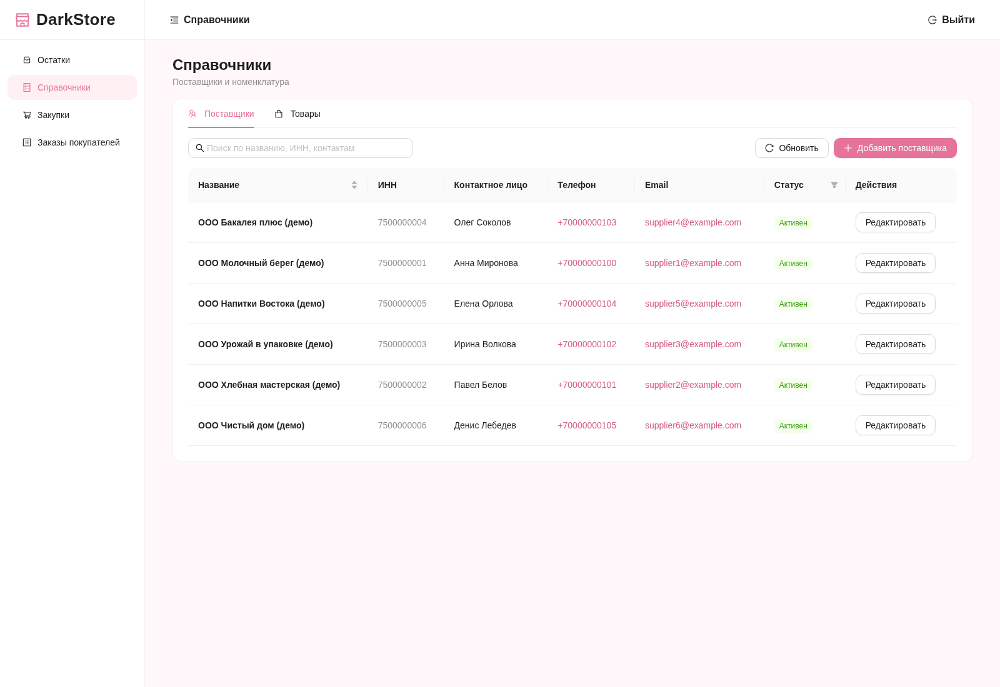

# DarkStore

Сервис для заказов и доставки из даркстора. Сейчас делаю CRM склада, дальше планирую добавить клиентское приложение и приложение для сборщиков и курьеров.

## Что уже есть

- Вход для сотрудников.
- Справочники товаров и поставщиков, загрузка фотографий товаров.
- Учёт остатков и резервов.
- Создание и приёмка закупок.
- Заказы покупателей: состав заказа, сборка, передача курьеру, доставка и отмена.
- Валидация форм и обработка ошибок API.

## Скриншоты

Заказы покупателей — от нового заказа до передачи курьеру.



Карточка заказа: данные покупателя, состав, сумма и действия.



Остатки: наличие товаров, резервы и доступное количество.



Закупки: заказы поставщикам, их статусы и приёмка.



Справочник товаров: номенклатура, цены и поставщики по умолчанию.



Справочник поставщиков: контакты, реквизиты и статус активности.



## Стек

**Фронтенд:** React, TypeScript, Ant Design, React Router, TanStack Query, Axios, Vite.

**Бэкенд:** Python, FastAPI, SQLAlchemy, PostgreSQL, Alembic, JWT.

## Запуск

Нужны Docker Compose и Bun. Команды выполняются из корня проекта.

Создай `.env`:

```env
POSTGRES_USER=darkstore
POSTGRES_PASSWORD=your-database-password
POSTGRES_DB=darkstore
SECRET_KEY=replace-with-a-long-random-string
```

Подними API и базу, примени миграции и создай сотрудника для входа:

```sh
docker compose up -d --build
docker compose exec api uv run --no-sync alembic upgrade head
docker compose exec api uv run --no-sync python -m scripts.create_user
```

Фронтенд запускается отдельно:

```sh
cd frontend
bun install
bun run dev
```

CRM — http://localhost:5173, документация API — http://localhost:8000/api/docs.

Про демонстрационные данные — в [app/scripts/README.md](app/scripts/README.md).
